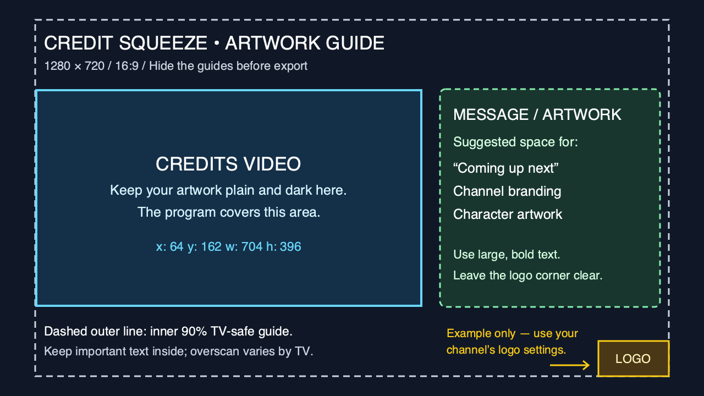

# Credit squeeze artwork template

Use this layout guide to keep your message clear of the credits video and an existing channel logo.

This template matches the still-image credit squeeze proposed in [PR96](https://github.com/TacoRocket/tunarr/pull/96), tracked in [issue 56](https://github.com/TacoRocket/tunarr/issues/56). It is an artwork aid, not a setting or an announcement that the feature is available in your installed container.

Download the [1280×720 PNG guide](assets/credit-squeeze-layout.png) or [editable SVG template](assets/credit-squeeze-layout.svg). Open the file and use **Download raw file** if GitHub shows a preview.

## Make your background

1. Start a **1280×720** canvas in your image editor. Add the PNG guide as a separate layer above your artwork and lower its opacity so you can see both. With the SVG, put artwork in the `artwork` group below `guides`.
2. Keep the credits rectangle plain and dark. Put your message and branding to its right, or in the top/bottom margins outside the rectangle. The green box is a suggested writing area, not a Tunarr crop or placement setting.
3. Check your channel’s existing logo position, width and margins. Reserve that area before placing text. The yellow box is only one example; Tunarr does not add a logo when squeeze is enabled.
4. Use large, bold, high-contrast text. Keep important words inside the dashed TV-safe boundary. This leaves 5% on each edge; individual TVs may crop more or less.
5. **Hide the guide layer/group**, then export your artwork as an opaque **1280×720 PNG in sRGB**. Do not use the labeled guide as your on-air background. Preview the result with your actual logo and CRT settings before using it.

## Exact boxes

Coordinates start at the top-left corner. Width and height describe the area; right and bottom edges are exclusive.

| Area | Left (x) | Top (y) | Width | Height | Meaning |
| --- | ---: | ---: | ---: | ---: | --- |
| Credits video | 64 | 162 | 704 | 396 | Fixed layout; the program covers this area. |
| Suggested message space | 800 | 162 | 400 | 396 | Editing advice only; other space outside the credits can also hold artwork. |
| TV-safe boundary | 64 | 36 | 1152 | 648 | Inner 90% guide for important text. |
| Example bottom-right logo | 1088 | 620 | 128 | 64 | A 2:1 logo at 10% canvas width, with 5% horizontal/vertical margins. |

The credits rectangle uses 5% left, 22.5% top, and 55% of the canvas width and height. For a 1920×1080 background, multiply these coordinates and dimensions by 1.5. The logo example scales the same way only if its settings and 2:1 aspect ratio match. A different logo shape, corner, size or margin needs a different reserved box.

The credits rectangle starts on the left TV-safe boundary and fits entirely inside it. The boundary is a layout guide, not a guarantee against every TV’s overscan.

## Coming later

A version of this template that matches your own channel's logo position and size, with a sample-credits preview, is planned. Until then, adjust the example logo box by hand.
