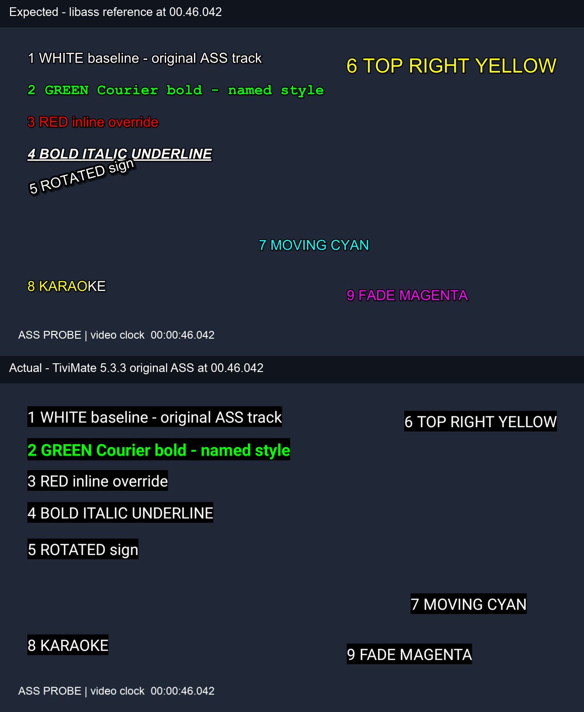

# Subtitles without burning them into 4K video

**Subtitle preparation** gives Tunarr reusable text subtitles that the player can
draw separately, avoiding the extra video processing needed to burn in PGS.
It can help both direct playback and transcoded channels.

## Choose the playback path

If your player supports the source video, start with
[HLS Direct v2 on ErsatzTV Next](transcoding.md#hls-direct-v2-on-ersatztv-next).
It can copy compatible video instead of encoding it again. Separate text
subtitles do not themselves require video encoding. Selecting PGS does: Next
burns those images into the video. It does not send PGS to the player as a
separate image overlay, as a disc player or a direct-file player might.

Burning subtitles into a 4K source while keeping 4K output is a **4K-to-4K
transcode**. Every video frame still has to be decoded and encoded, even though
the resolution stays the same. The subtitle overlay adds work to that pipeline.
Preparing text removes that overlay work; a channel configured to transcode
still does its video decode and encode.

Tone mapping is a separate choice. It converts HDR brightness and colors to SDR;
4K resolution alone does not require it. With compatible HDR output and a
supporting player/display, Next can preserve HDR. With SDR output, an HDR source
needs conversion to keep its picture usable. An SDR source does not need HDR
tone mapping, even when both input and output are 4K. See the
[On, SDR fallback and Off settings](transcoding.md#hdr-tone-mapping-on-ersatztv-next).

## Turn on preparation

1. Enable subtitles on the channel and allow external English text in its
   subtitle preferences. Exclude image-based subtitles when you want prepared
   text to win over embedded PGS. A profile's language, title, forced and SDH
   filters still decide which track plays.
2. Enable **WebVTT Sidecar Subtitles** in the feature flags for separate HLS text
   delivery. Your player must support the HLS subtitle track.
3. Enable [automatic preparation](transcoding.md#automatically-prepare-upcoming-subtitles)
   through the FFmpeg settings API. The default `selected` mode follows channel
   preferences across streaming modes, including transcoded channels. The
   separate `all_english` option prepares English even when those preferences
   would not select it; it does not override playback selection.

For one program, use the [single-program task](transcoding.md#prepare-subtitles-for-one-program)
to inspect the result or resolve a track choice before scheduling it.

The current order is:

1. Reuse suitable text already in the media or a valid Tunarr cache.
2. Import an existing English SRT or ASS attached to the configured Plex library
   item. Automatic preparation does **not** search online subtitle services.
3. If suitable text is unavailable, convert an embedded English PGS track to SRT
   with the OCR worker.

Ambiguous Plex or PGS tracks return `needs-selection`; Tunarr does not guess.
A Plex error stops that program's job rather than silently choosing OCR.
The ladder has no Jellyfin acquisition or Bazarr adapter yet; existing usable
text from those libraries can still be reused.

OCR requires the Linux container and a locally accessible Matroska file. It reads
subtitle data directly from that file without remuxing the movie to SUP. The
one-time preparation cost belongs before airing; a valid completed cache skips
OCR on later airings. The six-hour lookahead helps, but late additions, ambiguity,
slow jobs and the work allowance can still leave a program unprepared at airtime.

## What changes for playback

On an Intel Core i3-1220P, separate cached text gave this 4K sample about **46%
more throughput with HDR output** and **55% more with SDR output** than PGS
burn-in. All four cases still encoded 4K video; these are not direct-copy speeds.

| Same 4K HDR source, 4K output | PGS burned into video | Cached text delivered separately |
| --- | ---: | ---: |
| Preserve HDR | 1.86× | 2.72× |
| Convert to SDR | 1.03× | 1.60× |

**1× means processing video as fast as it plays.** SDR with burn-in was only just
above that mark in this sample. Text preparation gave it more room, but short
measurements do not establish sustained channel capacity or guarantee smooth
playback on a particular client.

The source is Dolby Vision profile 7 with an HDR10 base. It correctly uses Next's
existing libplacebo tone mapper for SDR, even with the optional LUT requested.
The HDR10-only LUT was **not** used, so this table does not measure the LUT port's
benefit. HDR output here means preserving the HDR10 base, not retaining Dolby
Vision enhancement data through the encode.

These are playback costs after a text subtitle is ready. Preparation is a separate
job: an earlier English PGS conversion of *A Charlie Brown Christmas* took about
106 seconds for 342 cues, then a repeated request reused its cache without OCR.
That is one title on one machine, not a conversion-time estimate for a feature
film. The four-case playback comparison reuses a previously acquired SRT; it does
not measure OCR of that movie or establish whole-movie subtitle accuracy.

Test setup and full numbers

Measured November 1, 2026, with the released ErsatzTV Next
[`v0.2.4-trfork.11`](https://github.com/TacoRocket/next/releases/tag/v0.2.4-trfork.11)
Linux x64 worker and packaged FFmpeg `8.1.2-etv.dev.a64ee856`.

- Source: *Braveheart* (1995), 3840×2160 HEVC, 24000/1001 fps, starting at
  02:25:17.930. The embedded PGS canvas is 1920×1080 and is scaled for the 4K
  overlay. The text cases use a previously acquired SRT.
- Output: 3840×2160 HEVC VAAPI, low-power encoding, 15 Mbps target/maximum,
  30 Mbps buffer; AAC stereo at 192 kbps. HDR uses 10-bit output and tone mapping
  Off; SDR uses 8-bit output and tone mapping On. No CRT shader or watermark.
- Each case encoded the same 719 frames from a 30-second excerpt, twice, with
  the second pass in reverse order. Speeds below use encoded duration divided
  by mean FFmpeg wall time. HDR versus SDR changes output bit depth as well as
  tone mapping; it is not a measurement of the mapper alone.
- An unrelated background video workload kept using the same GPU throughout,
  the same in every case, and no other benchmark ran at the same time. This was
  a matched comparison under normal background load, not an idle-GPU test.

| Output and subtitles | Run 1 | Run 2 | Mean processing time |
| --- | ---: | ---: | ---: |
| HDR + PGS burn-in | 1.814× | 1.910× | 16.113 s |
| SDR + PGS burn-in | 1.030× | 1.035× | 29.046 s |
| HDR + cached text | 2.716× | 2.717× | 11.039 s |
| SDR + cached text | 1.599× | 1.596× | 18.768 s |

The actual released worker generated each pipeline. A separate unpaced FFmpeg
replay kept its decode, filter, audio, encoder and HLS output options; only timing,
logging and output filenames changed. The timed numbers include HLS video muxing
but exclude the worker's WebVTT writer, Tunarr HTTP delivery and player decoding.

Separate worker runs produced HLS output for all four cases. Decoding a segment
from each succeeded; probes confirmed 10-bit PQ for HDR and 8-bit BT.709 for SDR.
The text cases emitted WebVTT cues matching the source SRT timing, with no PGS
overlay in their video commands. No hardware fallback was reported. This run
did not repeat the earlier Tunarr HTTP transition checks or test TiviMate/UHF.

## Styled ASS subtitles on TiviMate

**Keep burn-in when the subtitle appearance matters**, especially for anime with
translated signs, custom fonts or karaoke. Use cached WebVTT for ordinary dialogue,
or when you prefer less video processing and accept simpler subtitles. This is a
choice for each channel's subtitle preferences, not a reason to disable preparation.

We tested TiviMate **5.3.3 on an NVIDIA Shield running Android 11** on November 1,
2026. Original ASS displayed with some color and positioning, but it did not match
the full styling. The same subtitles burned into video with libass displayed
correctly on that device.

| What matters for your channel | Our recommendation |
| --- | --- |
| Preserve anime signs, fonts and effects | Burn in the original ASS. |
| Read ordinary SRT or OCR-prepared dialogue | Use separate cached WebVTT. |
| Reduce subtitle processing and accept simpler ASS text | Use cached WebVTT, checking a sample first. |

Burn-in preserves **subtitle appearance**; it does not improve the underlying
video. It requires encoding the video again, with the processing cost and possible
compression loss that brings. Separate text avoids that requirement, though other
channel settings can still require video transcoding.

Saving ASS in Tunarr's cache keeps the original file intact. The current separate
HLS path converts it to WebVTT before sending it to the player. In our test, that
conversion kept text and basic emphasis but removed colors and sign placement.
The subtitles appeared; the loss was in presentation, not a failure to display
cached text.

What the TiviMate ASS test showed

We used a temporary playlist with three versions of one synthetic 720p clip:
original ASS in an MKV with a font attached, a libass-burned reference, and separate
WebVTT over HLS converted from the same ASS. We selected the English track in
TiviMate's internal player and captured its output over ADB.

| Feature | Original ASS in TiviMate | After conversion to WebVTT |
| --- | --- | --- |
| Text and simultaneous subtitle lines | Displayed | Displayed, stacked at the bottom |
| Green color and bold from a named style | Preserved | Bold survived; green was lost |
| Static position and alignment | Preserved | ASS placement was lost |
| Inline color changes | Ignored | Removed during conversion |
| Inline bold, italic and underline | Ignored | Preserved as basic text emphasis |
| Attached Courier font and inline size change | Not preserved | Not preserved |
| Rotation, motion, karaoke and fades | Not preserved; moving text stayed at its final position | Not preserved |

Both frames show 46.042 seconds. The lower image is an ADB screenshot resized to
the clip's 1280×720 resolution; the upper image is the matching libass reference
frame. TiviMate applied black caption backgrounds in this setup.

The WebVTT file already lacked the ASS colors and positions before TiviMate read
it. That conversion loss is separate from the limitations seen when TiviMate read
the original ASS. Delivering original ASS could retain more static styling, but
would not recover full typesetting in this tested version.

This was a client capability check, not a new Tunarr live-channel test. It did not
test every ASS feature, other TiviMate versions, mid-cue tune-in or program
transitions, and MKV playback does not establish an original-ASS delivery path
through live HLS. Other players may render ASS differently.

We tested this because avoiding burn-in should not mean unexpectedly losing the
translated sign or song effect someone chose that subtitle track for. The ladder
remains useful for readable separate text; burn-in remains the dependable choice
for the original ASS appearance on this TiviMate version.

## Keep in mind

- **Wording and styling:** OCR can misread words and loses PGS positioning and
  artwork. Imported ASS remains intact in the cache, but WebVTT cannot reproduce
  its full typesetting, animation or karaoke. Burn-in remains useful when that
  appearance matters more than throughput.
- **Joining mid-line:** Next includes the remaining part of an active cue in its
  WebVTT output. A diagnostic AVPlayer client skipped that first line during
  startup; this has not established TiviMate or UHF behavior. Later cues retained
  their timing. See the [playback limits](transcoding.md#subtitles-in-direct-hls-v2).
- **Reuse and retention:** an acquired copy survives Plex rescans and stays while
  its program is in the library or recoverable Trash. Deleting the program or
  emptying Trash makes it eligible for cleanup. Replacement media invalidates
  stale results. Keep Tunarr's cache on persistent storage.

We added preparation so smaller servers can spend less of their playback budget
drawing subtitles into every frame. It gives users a choice between the original
subtitle appearance and cheaper separate text delivery.
